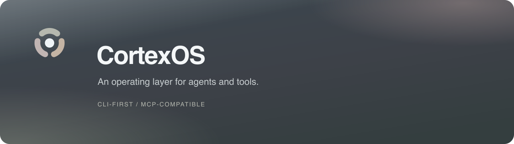

<p align="center">
  
</p>

<p align="center">
  <strong>面向 AI 协作的个人工作系统</strong><br>
  把工具、项目上下文和任务执行，组织成一套可以持续使用的工作流。
</p>

<p align="center">
  <a href="https://github.com/cortexos-dev/cs-mcp">开始使用 cs-mcp</a> ·
  <a href="https://github.com/cortexos-dev/cs-mcp/releases/latest">下载最新版本</a> ·
  <a href="https://github.com/cortexos-dev/cs-mcp/issues">反馈与建议</a>
</p>

### 三个产品

| 产品 | 定位 |
| --- | --- |
| **[cs-ui-web](https://github.com/cortexos-dev/cs-ui-web)** | 电脑端工作台（网页 + Mac app）：Agent 与人共用的控制面，任务、看板与消息在同一处收敛 |
| **[cs-mcp](https://github.com/cortexos-dev/cs-mcp)** | CortexOS 的 MCP 接入层：探测本机 CLI，把工具能力注册成 MCP 分组供 AI 客户端调用 |
| **[cs-app](https://github.com/cortexos-dev/cs-app)** | 手机端工作台：随身查看任务进展、收发消息与指令，桌面端能力的移动入口 |

三端共用同一套标记，**logo 真源在 [`cs-app/client/design/logo`](https://github.com/cortexos-dev/cs-app)**（`logo-mark.svg` + `build_logo.py`）。

### 从工具接入开始

CortexOS 以 CLI 为基础，让 AI Agent 使用已有工具处理真实工作。MCP 为支持该协议的客户端提供统一入口；具体能力仍由各工具自己的 CLI 实现。

目前公开发布的是 **[cs-mcp](https://github.com/cortexos-dev/cs-mcp)**：它会探测本机已经安装的 CLI，注册对应的能力分组。需要什么就安装什么，让工具清单跟着你的实际环境变化。

| 你想做什么 | cs-mcp 如何连接 |
| --- | --- |
| 生成与处理图片、视频 | 接入 MUSE AV 与本地媒体工具 |
| 看图、排版、制作短视频 | 调用本地视觉模型、Facet 和 Reel |
| 检查界面对比度与项目质量 | 连接 Contrast Guard 与 Scorecard |
| 在真实浏览器里完成操作 | 使用浏览器会话与人工登录交接 |
| 整理内容与本机聊天资料 | 连接写作工具与本机微信数据通道 |

各分组的安装条件、平台限制和是否调用云服务，见 [能力清单](https://github.com/cortexos-dev/cs-mcp#能力分组)。云能力可能需要独立账号或配额，本地能力取决于这台机器的配置。

### 接入你的 AI 客户端

```bash
curl -fsSL https://raw.githubusercontent.com/cortexos-dev/cs-mcp/main/install.sh | bash
```

安装后，将 `~/.local/bin/cs-mcp` 配置为客户端的 stdio MCP 服务。Claude Code 用户可使用：

```bash
claude mcp add cs -- ~/.local/bin/cs-mcp
```

完整安装与配置：[中文文档](https://github.com/cortexos-dev/cs-mcp#readme) · [English](https://github.com/cortexos-dev/cs-mcp/blob/main/README.en.md)

### 品牌素材

组织标识、头像与横幅的完整说明见 [brand/README.md](https://github.com/cortexos-dev/.github/blob/main/brand/README.md)，颜色与来源记录见 [brand/manifest.json](https://github.com/cortexos-dev/.github/blob/main/brand/manifest.json)。

| 用途 | 素材 |
| --- | --- |
| 浅底透明标识 | [mark.svg](https://raw.githubusercontent.com/cortexos-dev/.github/main/brand/mark.svg) |
| 深底标识 | [mark-dark.svg](https://raw.githubusercontent.com/cortexos-dev/.github/main/brand/mark-dark.svg) |
| 组织头像 1024×1024 | [avatar.png](https://raw.githubusercontent.com/cortexos-dev/.github/main/brand/avatar.png) |
| 首页横幅 1280×360 | [hero.png](https://raw.githubusercontent.com/cortexos-dev/.github/main/brand/hero.png) |

---

<sub>CortexOS 由 <a href="https://github.com/webkubor">webkubor</a> 维护。cs-mcp 目前是公开入口，其他组件仍在内部迭代。</sub>
